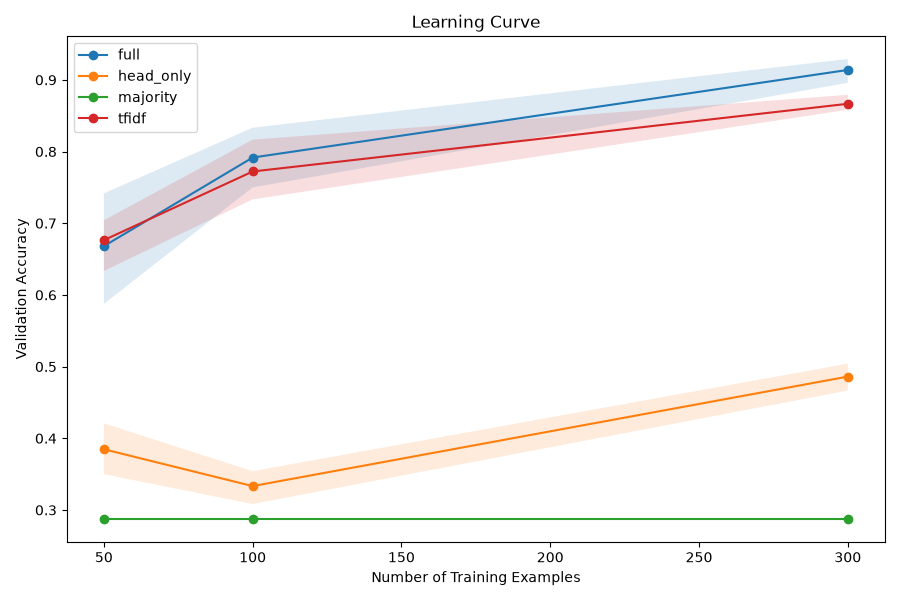
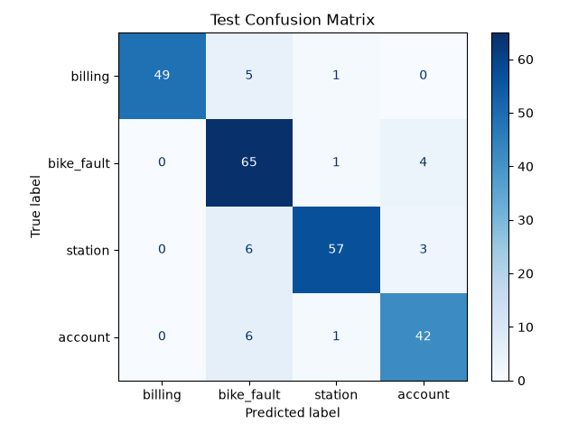

# Lakeshore Ticket Sorter: fine-tuning against a baseline

Model: Saved locally in the model/ folder.

Space: Not deployed due to Hugging Face access limitations discussed with the instructor.

## What it does

This project uses AI to organize customer support messages for Lakeshore Bike Share into four categories:

- Billing
- Bike fault
- Station
- Account

The goal is to compare traditional machine learning methods with a fine-tuned DistilBERT model and determine which performs best.

## How to run it

Create and activate the environment:

```bash
conda env create -f environment.yml
conda activate lab09-fine-tune-and-publish
```

Run the experiments and recreate the saved model:

```bash
python run_experiments.py
```

Launch the local Gradio app:

```bash
python app.py
```

Run the tests:

```bash
python -m pytest
```

## Data and split

The dataset contains 1,200 generated customer support messages.

| Dataset | Messages |
|---|---:|
| Training | 720 |
| Validation | 240 |
| Testing | 240 |

A stratified 60/20/20 split was used with a fixed seed of 42. An additional 40 messages were written independently to evaluate the models on unfamiliar wording.

## Methods

Four methods were compared:

- Most common label baseline
- TF-IDF with logistic regression
- Head-only DistilBERT fine-tuning
- Full DistilBERT fine-tuning

Each method was tested using 50, 100 and 300 training examples with seeds 42, 7 and 11.

The fine-tuning settings were:

- Learning rate: 5e-5
- Epochs: 3
- Batch size: 16
- Maximum message length: 128 tokens

Full fine-tuning with 300 examples was selected because it achieved the highest average validation accuracy.

## Results

### Average validation accuracy

| Method | 50 examples | 100 examples | 300 examples |
|---|---:|---:|---:|
| Most common label | 28.75% | 28.75% | 28.75% |
| TF-IDF | 67.64% | 77.22% | 86.67% |
| Head-only | 38.47% | 33.33% | 48.61% |
| Full fine-tuning | 66.81% | 79.17% | 91.39% |

### Validation accuracy ranges across seeds

| Method | 50 examples | 100 examples | 300 examples |
|---|---|---|---|
| Most common label | 28.75–28.75% | 28.75–28.75% | 28.75–28.75% |
| TF-IDF | 63.33–70.42% | 73.33–81.67% | 85.83–87.92% |
| Head-only | 35.00–42.08% | 30.83–35.42% | 46.67–50.42% |
| Full fine-tuning | 58.75–74.17% | 75.00–83.33% | 89.58–92.92% |

### Learning curve



### Final test results

| Method | Accuracy | Macro F1 |
|---|---:|---:|
| Most common label | 29.17% | 0.1129 |
| TF-IDF | 82.92% | 0.8286 |
| Full fine-tuning | 88.75% | 0.8899 |

### Confusion matrix



All experiment results are saved in the reports/ folder.

## Your own 40 messages

I created 40 additional customer support messages, with 10 messages for each category.

| Method | Accuracy | Macro F1 |
|---|---:|---:|
| Most common label | 25.00% | 0.1000 |
| TF-IDF | 77.50% | 0.7726 |
| Full fine-tuning | 82.50% | 0.8070 |

Full fine-tuning performed the best, although its accuracy decreased compared to the original test dataset. This suggests that unfamiliar wording can make classification more difficult.

## Publishing

The trained model is saved locally in the model/ folder. The model weights are not committed to GitHub because of their large file size.

The model card is available in MODEL_CARD.md.

The Gradio app runs locally and displays a confidence score for each support category. Hugging Face Spaces deployment was skipped with instructor permission.

## Tests

All 17 tests passed locally.

The tests cover:

- Data splitting and sampling
- Baseline performance
- Tokenization
- Model freezing
- Full fine-tuning
- Repeatable results
- Memorizing a small batch
- Saving and reloading the model
- Model card headings
- App predictions and empty input

## Limitations

The training data contains invented customer messages rather than actual customer complaints. The model may struggle with unfamiliar wording, unclear complaints or messages involving multiple issues.

More testing with real customer messages would be needed before using the model in a real customer support environment. Human review is still recommended.